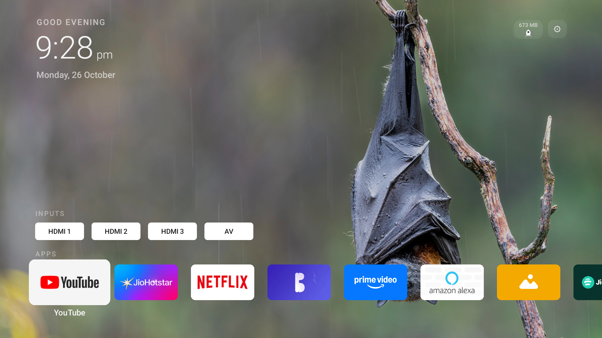
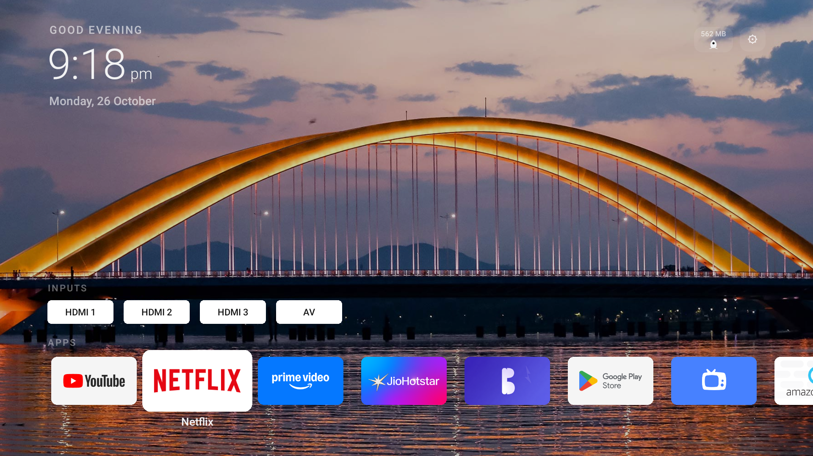
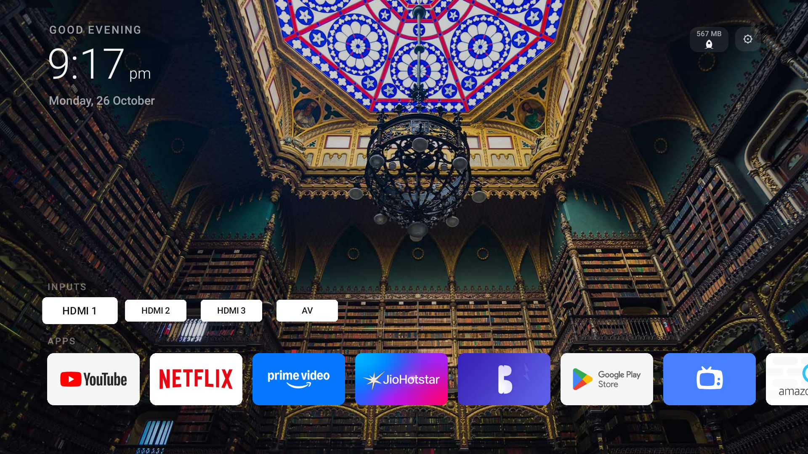
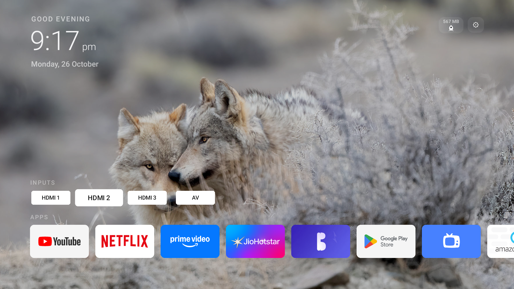

# Make Android TV 10x Faster 🚀

<p align="center">
  <b>Transform your slow, laggy Android TV into a blazing-fast, responsive, and modern entertainment hub.</b><br>
  No ads. No tracking. No bloatware. Just instant remote-control response, daily 4K dynamic wallpapers, and pure speed.
</p>

<p align="center">
  <a href="#-features"></a>
  <a href="#-installation"></a>
  <a href="LICENSE"></a>
  <a href="#-privacy-first"></a>
</p>

---

## 📸 Screenshots from Actual TV

Captured directly from an Android TV running this launcher and optimization setup:

### 1. Minimalist Home Screen & Daily 4K Bing Wallpapers
Clean layout featuring dynamic time-based greetings, live clock, real-time RAM monitor rocket, and bottom-docked inputs and apps.
<p align="center">
  
</p>

---

### 2. Fluid Dock Magnification on Apps
Zero ugly focus borders or rings. Navigating apps with the remote triggers a fluid macOS-style dock zoom animation with subtle drop-shadow elevation.
<p align="center">
  
</p>

---

### 3. Minimalist White Box Inputs with Active Glow
Hardware input ports (`HDMI 1`, `HDMI 2`, `HDMI 3`, `AV`) are rendered as sleek white pill buttons with crisp typography. When an external device connects, the box radiates a soft emerald active glow and displays the identified HDMI-CEC console name.
<p align="center">
  
</p>

---

### 4. Seamless D-Pad Navigation & Rolling Art
Intuitive remote-control focus search effortlessly moves between top booster chips, inputs, and apps without jitter or delay.
<p align="center">
  
</p>

---

## ✨ Why Android TVs Get Slow (And How This Fixes It)

| Problem in Stock Android TV / Google TV | How "Make Android TV 10x Faster" Solves It |
| :--- | :--- |
| **Heavy Stock Launcher**: 150MB+ RAM eaten by sponsored video trailers, banner ads, and recommendation rails. | **Ultra-Lightweight Launcher**: Under **66 KB** total APK size. Uses negligible RAM (~15MB total) and responds in 16ms (60 FPS). |
| **Background Bloat**: Pre-installed manufacturer services continuously wake up the CPU, causing remote input lag. | **1-Click Rocket Memory Booster**: Instantly terminates background tasks, clears OS caches, and trims idle memory. |
| **Network & Ad Congestion**: Trackers and ads saturate home Wi-Fi and delay stream initialization. | **System-Wide Ad-Block DNS**: Preconfigured to drop ad servers and telemetry at the network layer. |
| **Static or Generic Wallpapers**: Boring static backdrops or heavy wallpaper engines that drain memory. | **Rolling 4K Daily Bing Spotlight**: Automatically fetches Microsoft Bing's global daily photo of the day across 8 worldwide regions with smart offline caching. |

---

## ⚡ Features

* 🚀 **Ultra-Fast 66 KB Native Launcher**: Built with pure Android SDK components (no heavy Jetpack Compose or webview overhead).
* 🖼️ **Daily Dynamic 4K Wallpapers**: Automatically downloads and rotates the newest daily curated spotlights from Microsoft Bing across global markets (`en-US`, `en-IN`, `en-GB`, `ja-JP`, `de-DE`, `fr-FR`).
* 🧹 **1-Click Free RAM Booster**: A dedicated monochrome rocket icon in the top-right corner shows real-time free RAM in MB/GB. Clicking it force-stops background hogs and clears cached memory instantly.
* 🛡️ **Built-in Ad-Block DNS Support**: Step-by-step setup for AdGuard DNS to block YouTube and TV banner ads natively without installing bulky VPN apps.
* 🎮 **Dynamic HDMI-CEC Device Detection**: Automatically displays console names (e.g. PlayStation 5, Xbox, Apple TV) when an active device is plugged in; remains a clean, compact hardware pill otherwise.
* 🔍 **macOS-Style Magnifier Animation**: Smooth zoom and scale transitions on remote control hover with zero harsh border strokes.
* 🕒 **Time-Aware Dynamic Greetings**: Greets you with "Good Morning", "Good Afternoon", or "Good Evening" based on your local timezone.
* 🔒 **100% Private & Open Source**: No accounts required, no telemetry collected, and zero analytic beacons.

---

## 🛠️ Quick Installation Guide

You can install the optimized launcher directly to any Android TV, Google TV, or Fire TV stick using standard ADB over Wi-Fi.

### Prerequisites
1. Enable **Developer Options** and **USB / Network Debugging** on your TV:
   * **Android TV / Google TV**: Go to `Settings › Device Preferences › About › Build`, click **Build 7 times**, then go to `Developer Options` and enable **Network Debugging**.
   * Note your TV's IP address (e.g. `192.168.1.36`) from `Settings › Network & Internet`.

### Install via ADB in 1 Minute

```bash
# 1. Connect to your TV over Wi-Fi
adb connect <YOUR_TV_IP>:5555

# 2. Clone this repository
git clone https://github.com/akashth11/make-android-tv-10x-faster.git
cd make-android-tv-10x-faster

# 3. Build and install the launcher
cd launcher
bash ./build.sh
adb -s <YOUR_TV_IP>:5555 install -r build/dumbtv-home.apk

# 4. Start the launcher
adb -s <YOUR_TV_IP>:5555 shell am start -n tv.dumbtv.home/.Home
```

---

## 🛡️ Block All Ads with Private DNS

To eliminate ads across your entire TV without running third-party adblock apps:

```bash
# Enable AdGuard Private DNS on your TV via ADB
adb -s <YOUR_TV_IP>:5555 shell settings put global private_dns_mode hostname
adb -s <YOUR_TV_IP>:5555 shell settings put global private_dns_specifier dns.adguard-dns.com
```

To verify ad blocking is active:
```bash
adb -s <YOUR_TV_IP>:5555 shell ping -c 1 googleads.g.doubleclick.net
# Returns 127.0.0.1 or unreachable, confirming ads are blocked at the DNS level!
```

---

## 🧹 Debloating Slow Android TV Services

To safely disable manufacturer bloatware and background tracking:

```bash
# Disable Xiaomi / Patchwall / Amazon bloatware safely
bash ./scripts/debloat.sh <YOUR_TV_IP>
```

To restore any disabled package at any time:
```bash
adb -s <YOUR_TV_IP>:5555 shell pm enable <package.name>
```

---

## 📂 Project Structure

```
make-android-tv-10x-faster/
├── docs/
│   └── screenshots/              # Real captures from actual Android TV
│       ├── 01_minimalist_home.png
│       ├── 02_apps_dock_magnification.png
│       ├── 03_inputs_navigation.png
│       └── 04_hdmi_dock_zoom.png
├── launcher/
│   ├── src/tv/dumbtv/home/       # Lightweight native Java source code
│   │   ├── Home.java             # Main activity, D-pad navigation & RAM booster
│   │   ├── Tile.java             # Pure canvas card rendering & dock zoom
│   │   ├── WallpaperFetcher.java # Global Bing 4K daily wallpaper engine
│   │   └── Catalog.java          # HDMI-CEC device & installed app manager
│   ├── AndroidManifest.xml
│   └── build.sh                  # Ultra-fast zero-Gradle CLI build script
└── scripts/                      # ADB automation scripts for debloating & DNS
```

---

## 🤝 Contributing

Contributions are welcome! If you have optimizations for specific TV models (Sony, TCL, Xiaomi, Hisense, Amazon Fire TV), feel free to open a Pull Request or Issue.

---

## 📄 License

This project is open-source under the [MIT License](LICENSE).
